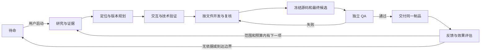

# ComicVerse OPC 团队与工作流

制定日期：2026-11-03（Asia/Hong_Kong）。本文件是项目工作约定，结合根目录 `AGENTS.md` 使用。目标是在用户设定的产品方向和执行范围内，形成可追溯的研究、规划、开发、验收、反馈循环。

规范首次落地时只完成团队规范与配置，`control.json`初始为`standby`，当时没有启动产品迭代、调研、构建或后台执行。首次产品基线为Windows ComicVerse v1.3.1。此后实际执行状态以`control.json`和对应轮次记录为准；2026-11-03用户已明确启动[CV-20261103-01](cycles/CV-20261103-01/run.md)。

## 团队：1 个主 agent＋8 个子角色

用户是产品方向与授权的最终负责人，不计入 agent 数量。主 agent 保留跨阶段上下文，对结果负责；八个子角色按需要出场，不要求每一阶段都运行八份任务。

| Agent | 职责与输入 | 必须交付 | 主要边界 |
| --- | --- | --- | --- |
| 主 agent／leader | 读取用户目标、项目状态和证据，决定每轮范围、排期、文件分工、冲突处理及是否继续 | 轮次计划、决策记录、整合结果、冻结候选、交付核验、下一轮判断 | 不代签独立 QA；不把配置上限当实际并发；统一控制打包与正式交付 |
| `market_research` 市场与竞品 | 研究用户类型、阅读场景、渠道、替代方案、竞品定位和维护方式 | 市场细分、研究范围、竞品矩阵、关键流程比较、机会假设及来源日期 | “官方宣称”“实际体验”“推测”分列；渠道方案不授权对外发消息或发布 |
| `user_research` 用户研究与反馈 | 分析用户提供的反馈、观察和可授权使用的匿名材料；设计研究问题 | 用户画像假设、场景流程、痛点证据、反馈分级、版本效果评估 | AI 模拟不能充当访谈；无数据不编造满意度、留存率和迁移意愿；不读取真实书库来补证据 |
| `product_planner` 产品与版本规划 | 综合市场、用户、竞品和现有能力；提出定位和价值取舍 | 一句话定位、产品边界、排序待办、MVP／版本范围、PRD、逐条验收标准 | 对每个需求建立证据关联；不把竞品功能直接复制成需求；不以扩大范围维持循环 |
| `interaction_designer` 交互设计 | 将需求转成可完成的阅读／管理流程，与技术及 QA 对齐 | 主流程、状态转换、空态／错误／取消／恢复设计、原型、键盘操作与可用性验证计划 | 模拟走查与真实用户测试分开；默认修改设计文档，生产 XAML 由桌面开发负责 |
| `tech_architect` 技术架构与复核 | 审查现有 Core／WPF 结构、异步状态、存储兼容和性能约束 | 技术验证、影响面、接口与数据约定、风险及回退方案、开发后代码复核 | 默认不并行改生产文件；如亲自实现某项，须由非作者复核该项，且不能兼任最终 QA |
| `core_engineer` 核心开发 | 按获批需求和接口实现解析、导入、书库、持久化、缓存等 Core 能力 | 分配文件中的实现、必要自测、异常／取消／数据一致性结果及变更说明 | 不改他人持有的文件，不以自测替代最终验收，不读写用户真实书库 |
| `desktop_engineer` 桌面开发 | 按获批交互和接口实现 WPF、阅读状态、导航、显示与输入流程 | 分配文件中的实现、可运行的完整用户路径、必要自测及截图证据 | 不擅自扩产品范围；共享 App／测试入口必须先由 leader 指定单一文件 owner |
| `qa_acceptance` 独立质量验收 | 从 PRD 和风险独立设计正常、边界、异常及回归场景，复现缺陷 | 场景矩阵、缺陷证据、最终候选 PASS／FAIL、版本与哈希、未覆盖范围 | 不修本轮被验收产品代码，不由作者代签，不为了通过降低标准；QA 可在分配文件中维护独立验收夹具 |

主 agent 同时承担版本与交付负责人。这样保留两名实际开发者和一名独立 QA，不需要额外第九个子角色。研究、规划、设计、架构角色仍须产出可交给下游使用的成果。

## 九阶段及交接门槛

下表的产物保存在 `docs/opc/cycles/<轮次编号>/`；一次实际启动才创建该轮目录。统一模板见 [TEMPLATES.md](TEMPLATES.md)。已有有效成果可引用并记录适用性，不必每轮重做全部市场研究。

| 阶段 | 主责／协作 | 输入与产物 | 退出判据及失败回流 |
| --- | --- | --- | --- |
| 1. 市场分析 | 市场竞品／产品、leader | 用户方向、当前产品 → 用户细分、阅读场景、触达及维护假设、研究范围 | 每个判断注明来源与可信度；未确认市场假设留研究队列，不宣称商业验证 |
| 2. 用户研究 | 用户研究／交互 | 已授权反馈、访谈或观察材料 → 画像、用户任务、流程、痛点及频率／影响证据 | 区分样本与推断；证据不足则提出验证问题，不虚构用户结论 |
| 3. 竞品分析 | 市场竞品／交互、架构 | 阶段 1–2 的问题 → 竞品矩阵、同任务流程、取舍及机会假设 | 功能、价格、平台等易变事实核对官方来源并记日期；未安装实测如实标记 |
| 4. 产品定位 | 产品规划／leader决策 | 研究证据和现有边界 → 优先人群、核心问题、价值、迁移理由假设及不做项 | 目标具体、能检验且不超授权；冲突回研究，无需为常规取舍反复问用户 |
| 5. 需求与版本规划 | 产品规划／交互、架构、QA | 定位、问题优先级 → MVP／版本范围、PRD、成功指标、逐条验收、回退要求 | 每项需求有证据或明确实验目标；验收可观察，工作量可控；不具备条件则不标 READY |
| 6. 交互与技术验证 | 交互设计／技术架构、QA | PRD → 原型／流程、可用性反馈或模拟走查、必要技术验证 | 正常与失败路径可执行，关键技术风险有证据；不通过退回 4–5 调整或保持研究状态 |
| 7. 开发与迭代 | 两名开发／架构复核、leader整合 | READY 需求、接口、文件归属 → 完整用户路径、必要自测、代码复核记录 | 实现关联需求，相关检查通过，阻塞缺陷已处理；失败回开发，开发自测不能代替阶段 8 |
| 8. 独立测试与交付 | 独立 QA／leader打包与交付 | 冻结源码、最终包、PRD → QA结论、证据、版本及哈希、同制品交付核验 | QA明确 PASS 且哈希对应才可交付；FAIL → 开发修复 → 新候选 → 完整适用回归，不能沿用旧 PASS |
| 9. 试用与持续改进 | 用户研究／产品、leader | 已交付版本、获授权的实际反馈与测试观察 → 效果评估、待办变化、下一版计划 | 先判是否达到目标，再选下一步；真实反馈缺失标待验证，不能把自动化通过写成用户认可 |

## 执行状态与自主循环

`control.json` 是持久化入口，不是调度程序。leader 读取它和 [BACKLOG.md](BACKLOG.md)，核对用户最新指令；用户最新指令优先。执行中每次阶段、范围或交付变化都更新状态与该轮 `run.md`，结束前保存可供另一聊天恢复的交接。

收到未来启动指令时，leader 先把指令与范围写入 `run.md`，设置 `active_cycle`、`activation_required = false`、`mode = single_cycle` 或 `continuous`，登记本次实际轮数／预算，再转 `discovering` 或有充分依据的下一阶段。进入实际产品开发时才将 `authorization.product_development_started` 设为 `true`；结束或停止后清空 `active_cycle`、设回 `standby` 与 `activation_required = true`，该授权字段恢复为 `false`，完成情况保留在轮次记录。`blocked` 保留当前轮次及阻塞原因，恢复前核对最新指令和剩余预算。



- `execution_state` 可取 `standby`、`discovering`、`planning`、`validating`、`implementing`、`candidate`、`qa`、`delivered`、`evaluating`、`blocked`。无合适任务时回 `standby`，`last_outcome` 记 `no_action`，不伪装成一次产品发布。
- 待办状态为 `INBOX → RESEARCH → READY → IN_PROGRESS → CANDIDATE → QA → DONE`，另有 `BLOCKED`、`DEFERRED`。阶段 5 给出验收草案、阶段 6 通过后才可转 READY；已有明确复现和验收的缺陷可走精简研究路径。
- `DONE` 仅表示该需求已通过独立 QA 并以同一制品交付。用户价值另在 `evaluation.md` 记录“待反馈／已有观察／证据不足／目标达成／目标未达成”，不改变技术任务的完成事实；没有真实反馈不能把 DONE 扩大为用户价值已验证。
- 默认一次启动一轮，一轮最多选择 3 个同一用户目标下的需求；同一时间只推进一个发布候选。已明确授权的多轮模式可自主选择下一轮的合格任务，先登记轮数、时间预算和目标边界。
- 默认单轮工作预算 120 分钟、QA 失败后修复最多 2 轮。预算到达时不强行中断正在完成的文件写入；保存状态与证据，停止派发新工作。未完成、未验收内容不交付。用户可在启动时调整这些值。
- 缺少 READY 需求时，在已授权的目标和研究范围内可以补证据；没有可执行的验证手段、依赖真实反馈却尚未获得、需求超目标、缺乏必要权限、或修复上限用尽时，记录具体阻塞及下一步，回待命或 blocked。常规技术取舍由 leader 自主决定。
- 用户要求停止时，停止新任务，安全收尾和记录；崩溃／连接中断后的恢复先核对实际源码、进程、候选哈希和已完成动作，不能只凭旧状态文件重复构建、复制或发布。
- 配置不会让聊天结束后持续运行，也不会自行唤醒模型。本次不创建自动化；如果以后要求定时运行，再单独配置执行入口、预算、状态检查和通知条件。连续循环依然必须有可验证的改进目标。

## 分工与文件规则

1. 每个子任务包含：任务／需求编号、目标、输入证据、明确可写路径、依赖、验收标准、完成后交给谁。没有获分配的文件只读；需要扩大范围时先交 leader 重新分配，不碰撞他人文件。
2. Core 默认负责 `src/ComicVerse.Core/`；桌面默认负责 `src/ComicVerse.App/`。实际以 leader 分配的具体文件为准；`tests/ComicVerse.Tests/Program.cs`、App smoke 入口等共享文件一次只交给一人写。架构角色做复核，QA另维护获分配的验收文件。
3. 子角色不再派生子 agent；角色复用与收尾由 leader 统一管理。实际只有 3 个可用名额时分批执行，不能声称八个已并行，也不能把研究、QA和开发塞给同一作者冒充独立验收。
4. 长命令与等待遵守可用的 command-hang-guard、wait-subagent-guard。先定范围、超时和证据输出；等待每最多 60 秒核查存活。任务安静但仍运行不代表卡死。
5. 构建和 UI 测试遵守根 AGENTS：统一独立 Win32 Desktop 与测试数据目录，核对实际桌面、退出码与异常日志。使用实际 App 的 `--smoke`，不接管用户桌面，不复用真实书库，不恢复临时 WPF 宿主试错方式。

## 证据与优先级

证据使用 `E-<轮次>-NN`，需求使用 `REQ-<轮次>-NN`，缺陷使用 `BUG-<轮次>-NN`，候选使用 `<版本>-rcN`。记录关联链：证据 → 问题／机会 → 需求 → 变更与自测 → QA → 交付 → 效果。

| 证据类型 | 可支持的结论 | 必须保留的限制 |
| --- | --- | --- |
| 真实用户反馈 | 指定样本中发生的问题和主观诉求 | 样本数、来源、日期、授权及匿名化情况；不外推全部市场 |
| 实际运行／复现 | 指定版本、环境、数据下的行为 | 操作、期望／实际、日志／截图／退出码与可复现数据 |
| 官方文档／公开资料 | 来源声明的功能与政策 | URL、核对日期、引用范围；未经实测不写已体验 |
| 源码审查／假设／模拟 | 潜在风险、机会和待验证问题 | 明确“未实际复现”或“模拟”；不能充当真实用户证据 |

先处理数据丢失、崩溃和已确认的核心流程故障，再比较问题频率、影响、证据可信度与实现成本。产品规划给出排序理由，leader拍板；P0/P1 阻塞缺陷不能靠功能优先级分数被挤掉。为关键结论记录反例和否定证据；无法证明改善时可选择不改。

不自动新增遥测，不擅自读取个人书库／日志，也不联系外部用户来完成研究。已有用户明确提供或授权使用的反馈可按范围分析；合成数据与内部回归只能证明对应技术场景。

## 冻结、验收、交付

1. leader 整合开发结果、架构复核和相关自测，处理阻塞缺陷，冻结源码／构建输入／工具清单，构建并整理最终候选 EXE、ZIP、说明及样例。
2. 候选记录版本、基线提交、当前变更、源码与工具哈希、EXE和ZIP的SHA256、打包参数和证据目录。尚未提交的源码可用完整 manifest 标识，不能用旧 commit 冒充实际候选。
3. QA独立核对候选及 ZIP 内 EXE 一致，使用包内材料和隔离数据执行适用的正常、边界、异常及旧功能回归，记录实际桌面、退出码、日志、截图、异常与未覆盖项，并核对运行前后源码／制品未变。
4. 只有独立QA的明确 PASS 才可放行指定候选。FAIL 保留缺陷与证据，修复后重新冻结、打包并验收；改动被验收源码、工具或包内容即使很小，也不得沿用原结论。
5. leader 将已通过的同一 EXE 复制到 `publish/ComicVerse.exe`，ZIP放 `dist/`；不另建版本目录作为最终位置，不重新构建。按已有授权关闭已确认路径位于本项目的 ComicVerse，优先正常关闭。交付后核验哈希，清理本次临时版本目录。
6. 远端推送、打标签和发布遵守对话授权。标签不自动重建公开发布，手动build-release仅生成候选artifact及隔离证据。正式Release以草稿上传已批准同一制品，独立核对远端资产哈希后公开并复核；若选择新的CI重建候选，则必须对它重新独立验收，不能沿用本地PASS。远端路径未满足门禁时可完成本地交付并记录远端未执行。
7. 首次规范配置交付仅冻结规范文件、静态验证语法／角色／状态／门禁，再由独立QA检查同一候选，没有构建、运行或替换EXE；该历史规范验收不能写成ComicVerse功能已重新测试。后续获授权的产品迭代须执行上述产品制品门禁。

## 配置与启动方式

项目配置在 `.codex/config.toml`，8 个自定义角色文件在 `.codex/agents/`。角色继承当前模型、推理设置与权限，不自行改变 sandbox 或扩大权限。`max_concurrent_threads_per_session = 8` 的计数不含主 agent。[OpenAI 官方子 agent 配置文档](https://learn.chatgpt.com/docs/agent-configuration/subagents)（核对于 2026-11-03）。

文件存在和 TOML 解析成功仅证明配置已落地。实际加载、角色可选状态与并发上限由客户端版本及当前会话运行时决定；当前会话此前报告只有 3 个子 agent 可同时活动，不能仅凭文件改为 8 就宣称已扩容。支持命名角色时按角色派发；若当前工具没有角色选择参数，leader先读取对应 TOML 的 `developer_instructions`，将其和任务分工作为子任务上下文，不声称客户端已原生加载。

用户之后可使用以下指令启动；这些示例不是当前启动授权：

```text
启动 ComicVerse OPC，运行 1 轮，预算 120 分钟。
目标：<希望改善的用户任务或问题>。
按既有工作流补齐必要证据、规划、开发与最终包独立 QA；
通过后本地交付，远端发布按当前会话已有授权处理。
```

```text
启动 ComicVerse OPC 连续模式，最多 3 轮、总预算 240 分钟。
目标边界：<用户人群、阅读场景和不做项>。
每轮先评估效果，只推进有依据且可验收的改进；没有合格下一步就保存状态并停止。
```

每轮结束用简报说明：解决了什么、基于什么证据、改变了什么、哪些检查通过、哪些未覆盖、实际交付版本及哈希、是否继续及理由。避免把不断输出文档或测试数量本身当成用户价值。
